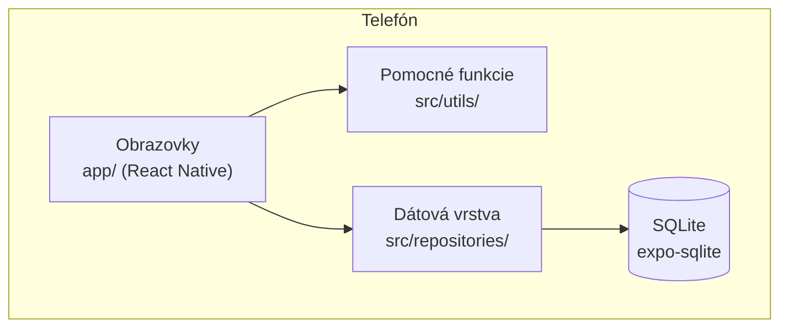
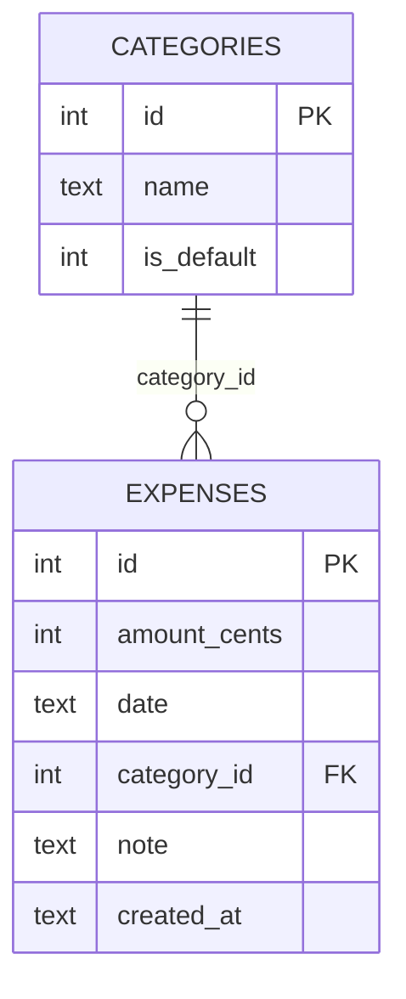

# Návrh: aplikácia na evidenciu výdavkov športovca

Tento dokument opisuje dátový model, rozhranie na prácu s dátami (API), štruktúru projektu a spôsob testovania. Zatiaľ neobsahuje žiadny kód. Vychádza zo `SPEC.md` (vrátane časti Rozhodnutia) a `BACKLOG.md` (user stories, akceptačné kritériá a testy).

## Prehľad architektúry

Aplikácia nemá server. Všetko beží v telefóne a dáta sú uložené lokálne v SQLite. Vrstvy:

1. **Obrazovky** (React Native): zobrazujú údaje a reagujú na klepnutia.
2. **Dátová vrstva** (repozitáre): jediné miesto, ktoré komunikuje s databázou. Obrazovky nikdy nepíšu SQL priamo.
3. **Databáza** (SQLite cez expo-sqlite): ukladá výdavky a kategórie.

Slovo „API" tu znamená funkcie dátovej vrstvy, ktoré volajú obrazovky. Nejde o internetové API.



Obrazovky môžu volať pomocné funkcie (formátovanie sumy, dátumu, výpočet percent) aj dátovú vrstvu. Pomocné funkcie nepoznajú databázu ani obrazovky, preto sa dajú samostatne testovať.

## Technológie

| Oblasť | Voľba | Prečo |
|---|---|---|
| Jazyk a rozhranie | TypeScript, React Native | jeden kód pre Android aj iOS, typová kontrola údajov (napríklad suma v centoch je vždy číslo) |
| Spustenie a zostavenie | Expo, testovanie v Expo Go | aplikácia sa spustí v telefóne naskenovaním QR kódu, netreba Android Studio ani Mac |
| Navigácia | Expo Router (priečinok `app/`) | obrazovky sa definujú súbormi, dolná lišta so záložkami cez `(tabs)` |
| Databáza | SQLite cez expo-sqlite | funguje bez internetu, podporuje SQL dotazy so súčtom a zoskupením (`SUM`, `GROUP BY`) na prehľad |
| Výber dátumu | @react-native-community/datetimepicker | systémový výber dátumu v Androide aj iOS, funguje v Expo Go |
| Graf | react-native-gifted-charts (s react-native-svg) | hotový kruhový graf, funguje v Expo Go |
| Testy | Jest (jest-expo) | unit testy pomocných funkcií bez telefónu |

## Dátový model

### Tabuľka `categories` (kategórie)

| Stĺpec | Typ | Popis |
|---|---|---|
| `id` | celé číslo, primárny kľúč | Jedinečný identifikátor |
| `name` | text, povinný, jedinečný | Názov kategórie (napríklad „Vybavenie") |
| `is_default` | 0 alebo 1 | 1 = základná kategória, 0 = vlastná kategória športovca |

### Tabuľka `expenses` (výdavky)

| Stĺpec | Typ | Popis |
|---|---|---|
| `id` | celé číslo, primárny kľúč | Jedinečný identifikátor |
| `amount_cents` | celé číslo, povinné, väčšie ako 0 | Suma v centoch (12,50 € sa uloží ako 1250) |
| `date` | text, povinný | Dátum výdavku vo formáte RRRR-MM-DD |
| `category_id` | celé číslo, povinné | Cudzí kľúč na `categories.id` |
| `note` | text, nepovinný, najviac 200 znakov | Poznámka k výdavku |
| `created_at` | text, povinný | Čas vytvorenia záznamu (ISO formát) |

### Vzťahy

- Jedna kategória má viac výdavkov (1 : N). Každý výdavok patrí práve do jednej kategórie.



### Typy v aplikácii (`src/types/`)

| Typ | Polia |
|---|---|
| `Category` | `id`, `name`, `isDefault` |
| `Expense` | `id`, `amountCents`, `date`, `categoryId`, `note`, `createdAt` |
| `ExpenseListItem` | `Expense` + `categoryName` (na zobrazenie v zozname) |
| `CategoryTotal` | `categoryId`, `name`, `totalCents` (na graf a legendu) |

### Rozhodnutia v modeli

- **Suma v centoch:** Ukladá sa ako celé číslo, aby sa predišlo chybám pri zaokrúhľovaní desatinných čísel. Na obrazovke sa zobrazí v eurách.
- **Dátum ako text RRRR-MM-DD:** Dá sa jednoducho zoradiť a filtrovať podľa mesiaca. Na obrazovke sa zobrazí ako DD.MM.RRRR.
- **Zoradenie zoznamu:** podľa `date` zostupne, pri rovnakom dátume podľa `created_at` zostupne.
- **Základné kategórie:** Vložia sa do databázy pri prvom spustení appky, len ak tabuľka `categories` ešte nemá žiadne základné kategórie (aby pri ďalšom spustení nevznikli duplikáty): vybavenie, štartovné a súťaže, tréner a tréningy, členské a poplatky, doprava, ubytovanie, strava a doplnky, zdravie a regenerácia, iné.
- **Mazanie kategórií:** Podľa rozhodnutia v `SPEC.md` sa kategórie v prvej verzii nemažú ani nepremenúvajú. Dátová vrstva preto nemá funkciu na zmazanie kategórie a nevzniká výdavok bez kategórie.

### Verzia databázy

Číslo verzie databázy sa ukladá v SQLite (`PRAGMA user_version`). Pri každom spustení appka verziu skontroluje a spustí iba chýbajúce kroky:

| Verzia | Obsah |
|---|---|
| 1 | tabuľky `categories` a `expenses`, index na `expenses.date`, vloženie základných kategórií |

Keď sa v ďalšej verzii zmení dátový model (napríklad pribudnú opakované výdavky), pridá sa verzia 2 s vlastným krokom (napríklad `ALTER TABLE`). Existujúce kroky sa už nemenia, aby športovec po aktualizácii appky neprišiel o zapísané výdavky.

## Rozhranie dátovej vrstvy (API)

### Kategórie

| Funkcia | Čo robí | Vráti | Pre user story |
|---|---|---|---|
| `getCategories()` | Vráti všetky kategórie (základné aj vlastné), najprv základné v pevnom poradí, potom vlastné podľa abecedy | `Category[]` | 2.1 |
| `addCategory(name)` | Pridá vlastnú kategóriu, odmietne prázdny alebo duplicitný názov | nová `Category` alebo chyba validácie | 2.2 |

### Výdavky

| Funkcia | Čo robí | Vráti | Pre user story |
|---|---|---|---|
| `addExpense(amountCents, date, categoryId, note)` | Uloží nový výdavok | `id` nového výdavku | 1.1, 1.2, 1.3 |
| `getExpenses()` | Vráti zoznam výdavkov od najnovšieho, aj s názvom kategórie | `ExpenseListItem[]` | 3.1 |
| `getExpense(id)` | Vráti jeden výdavok na úpravu | `Expense` alebo nič, ak neexistuje | 3.2 |
| `updateExpense(id, amountCents, date, categoryId, note)` | Uloží zmeny existujúceho výdavku | – | 3.2 |
| `deleteExpense(id)` | Zmaže výdavok | – | 3.3 |

### Prehľad

Parameter `month` je text vo formáte RRRR-MM (napríklad `"2026-11"`).

| Funkcia | Čo robí | Vráti | Pre user story |
|---|---|---|---|
| `getMonthTotal(month)` | Vráti súčet výdavkov za vybraný mesiac | súčet v centoch (0, ak nie sú výdavky) | 4.1 |
| `getTotalsByCategory(month)` | Vráti súčet výdavkov za mesiac zoskupený podľa kategórie, od najväčšieho. Obsahuje len kategórie s výdavkami. Tieto údaje slúžia na kruhový graf aj na legendu | `CategoryTotal[]` (prázdny zoznam, ak nie sú výdavky) | 4.2 |

### Pomocné funkcie (`src/utils/`)

Čisté funkcie bez databázy, preto sa dajú testovať unit testami (pozri časť Testovanie v `BACKLOG.md`).

| Funkcia | Čo robí | Unit test |
|---|---|---|
| `parseAmount(text)` | Prevedie zadaný text na centy, prijme čiarku aj bodku, pri neplatnej sume vráti chybu | U1 |
| `formatAmount(cents)` | Prevedie centy na text v eurách (1250 → „12,50 €") | U2 |
| `getMonthRange(month)` | Vráti prvý a posledný deň mesiaca (RRRR-MM-DD) | U3 |
| `shiftMonth(month, delta)` | Posunie mesiac o +1 alebo −1, aj cez prelom roka | U4 |
| `formatDate(date)`, `todayString()` | Zobrazenie dátumu ako DD.MM.RRRR a dnešný dátum ako RRRR-MM-DD | U4 |
| `calcPercentages(amounts)` | Vypočíta percentá zo súm, zaokrúhlené na celé čísla | U5 |
| `validateCategoryName(name, existing)` | Oreže medzery a skontroluje prázdny a duplicitný názov | U6 |

### Pravidlá validácie

- Suma je povinná, musí byť väčšia ako 0 a zadáva sa v eurách s najviac dvoma desatinnými miestami. Ako oddeľovač sa prijme čiarka aj bodka.
- Dátum je povinný, predvolene dnešný. Môže byť aj v budúcnosti.
- Kategória je povinná a musí existovať.
- Poznámka je nepovinná, najviac 200 znakov.
- Názov novej kategórie sa oreže o medzery na začiatku a konci, nesmie byť prázdny a nesmie sa zhodovať s existujúcou kategóriou bez ohľadu na veľké a malé písmená. Porovnanie robí dátová vrstva (`toLocaleLowerCase('sk')`), pretože SQLite pri porovnaní bez ohľadu na veľkosť písmen nezvláda slovenské znaky s diakritikou.
- Pri chybe validácie sa záznam neuloží a pri poli sa zobrazí hláška: „Zadaj sumu", „Suma musí byť väčšia ako 0", „Suma môže mať najviac dve desatinné miesta", „Vyber kategóriu", „Zadaj názov kategórie", „Kategória už existuje".

## Kruhový graf (Prehľad)

- **Knižnica:** react-native-gifted-charts, jej kruhový graf (pie chart).
- **Zdroj údajov:** funkcia `getTotalsByCategory(month)`. Graf nemá vlastné dáta, len zobrazuje jej výsledok pre vybraný mesiac.
- **Komponent:** `CategoryPieChart` v `src/components/`. Dostane zoznam kategórií so sumami a vykreslí graf aj legendu.
- **Legenda:** Pri každej kategórii je farba, názov, suma v eurách a percento z mesačného súčtu zaokrúhlené na celé číslo. Percentá sa počítajú v appke zo súm (`calcPercentages`), preto po zaokrúhlení nemusia dať presne 100 %.
- **Farby:** Každá kategória má pevne priradenú farbu, aby bola rovnaká pri prepnutí mesiaca. Vlastné kategórie dostanú ďalšie farby z palety.
- **Prázdny stav:** Podľa rozhodnutia v `SPEC.md` sa pri mesiaci bez výdavkov namiesto grafu zobrazí text „V tomto mesiaci nemáš žiadne výdavky".
- **Prepínanie mesiacov:** Po zmene mesiaca sa graf aj mesačný súčet načítajú znova.

## Obrazovky a navigácia

Dolná lišta s dvoma záložkami:

| Obrazovka | Účel | User stories |
|---|---|---|
| **Výdavky** (záložka) | Zoznam výdavkov od najnovšieho, tlačidlo „Pridať", prázdny stav „Zatiaľ nemáš žiadne výdavky" | 3.1 |
| **Prehľad** (záložka) | Mesačný súčet, prepínanie mesiacov, kruhový graf rozdelenia výdavkov podľa kategórií s legendou (suma a percento) | 4.1, 4.2 |
| **Nový / upraviť výdavok** | Formulár so sumou, dátumom, kategóriou a poznámkou; pri úprave aj tlačidlo „Zmazať" s potvrdením | 1.1 – 1.3, 3.2, 3.3 |
| **Nová kategória** | Dialóg alebo malá obrazovka s jedným poľom na názov | 2.2 |

Prechody: zo záložky Výdavky sa dá otvoriť formulár (nový alebo existujúci výdavok). Z formulára sa dá otvoriť dialóg na novú kategóriu a po uložení sa vybraná kategória nastaví na novú. Zoznam aj Prehľad sa pri každom zobrazení načítajú znova, aby ukazovali zmeny bez reštartu.

## Rozhodnutia a alternatívy

| Rozhodnutie | Zvažované alternatívy | Prečo takto |
|---|---|---|
| Mobilná appka v React Native + Expo | webová appka (PWA), natívna appka v Kotline | jeden kód pre Android aj iOS, testovanie v telefóne cez Expo Go bez Macu a bez plateného účtu |
| SQLite (expo-sqlite) | AsyncStorage, Firebase | dáta sú štruktúrované (výdavky a kategórie) a prehľad potrebuje súčty a zoskupenie, čo SQL robí priamo; Firebase by vyžadoval internet a účet |
| Suma v centoch ako celé číslo | desatinné číslo (REAL) | pri desatinných číslach vznikajú chyby zaokrúhlenia (0,1 + 0,2 ≠ 0,3) |
| Dátum ako text RRRR-MM-DD | časová pečiatka v milisekundách | dá sa čítať, zoradiť aj filtrovať podľa mesiaca (`LIKE '2026-11-%'`) bez prepočtu časových pásiem |
| Percentá sa počítajú v appke | počítať ich v SQL | jednoduchší dotaz, výpočet sa dá otestovať unit testom |
| Kategórie sa nemažú | mazanie s presunom výdavkov do „Iné" | prvá verzia je jednoduchšia a nikdy nevznikne výdavok bez kategórie |

## Riziká

| Riziko | Dopad | Opatrenie |
|---|---|---|
| Športovec vymaže dáta Expo Go alebo zmení telefón | stratia sa všetky výdavky | upozornenie v README; záloha a export v ďalšej verzii |
| Nová verzia Expo Go nepodporuje verziu Expo SDK v projekte | appka sa v telefóne nespustí | držať projekt na verzii SDK, ktorú podporuje aktuálne Expo Go, a po aktualizácii znova spustiť testy |
| Dnešný dátum sa určí v UTC namiesto miestneho času | medzi polnocou a 1:00 (v lete 2:00) by sa predvyplnil včerajší dátum | `todayString()` skladá dátum z miestneho času (`getFullYear`, `getMonth`, `getDate`), nie z `toISOString()` |
| Percentá v legende nedajú spolu 100 % | športovec si môže myslieť, že je chyba vo výpočte | sumy v legende sa vždy zhodujú s mesačným súčtom (test T4.2-5) |
| Veľa výdavkov v zozname | pomalé posúvanie zoznamu | zoznam cez `FlatList`, ktorý vykresľuje len viditeľné riadky |

## Testovanie

Podrobný zoznam testov je v `BACKLOG.md`: funkčné testy pri každej user story, ostatné v časti Testovanie na konci súboru.

- **Funkčné testy:** ručne v telefóne cez Expo Go, podľa tabuliek pri user stories v `BACKLOG.md`. Každý test overuje akceptačné kritériá danej story.
- **Nefunkčné testy:** overujú obmedzenia zo `SPEC.md` a ciele z initiative (offline, rýchlosť zápisu, zachovanie dát po aktualizácii).
- **Unit testy:** Jest s predvoľbou `jest-expo` pre pomocné funkcie v `src/utils/`. Súbory testov sú v `src/utils/__tests__/` a spúšťajú sa príkazom `npx jest`.
- **Kontrola kódu pred každým push:** `npx tsc --noEmit` (typová kontrola), `npx jest` (unit testy) a `npx expo lint`.
- User story je hotová, keď prešli všetky jej testy. Výsledok sa zapíše do tabuľky „Záznam z testovania" v `BACKLOG.md`.

## Štruktúra projektu

```
vma_zadanie/
├── app/                  obrazovky a navigácia
│   ├── (tabs)/           záložky Výdavky a Prehľad
│   └── expense/          formulár nového a upravovaného výdavku
├── src/
│   ├── db/               pripojenie k databáze, vytvorenie tabuliek, základné kategórie
│   ├── repositories/     funkcie dátovej vrstvy (výdavky, kategórie, prehľad)
│   ├── components/       opakovane použité časti rozhrania (napríklad kruhový graf CategoryPieChart)
│   ├── utils/            práca so sumami (cent na euro), dátumami, percentami a validácia
│   │   └── __tests__/    unit testy pomocných funkcií (Jest)
│   └── types/            typy údajov (Expense, Category)
├── README.md             plán projektu
├── SPEC.md               špecifikácia a rozhodnutia
├── DESIGN.md             tento návrh
└── BACKLOG.md            initiative, epics, user stories, akceptačné kritériá, testy
```

## Poradie implementácie

1. Založiť Expo projekt a vytvoriť databázu s tabuľkami a základnými kategóriami. Nastaviť Jest.
2. Pomocné funkcie v `src/utils/` spolu s unit testami U1 – U6.
3. Dátová vrstva pre kategórie a výdavky.
4. Formulár nového výdavku a zoznam výdavkov (epic 1, 2.1 a 3.1).
5. Úprava a mazanie výdavku (3.2, 3.3).
6. Vlastné kategórie (2.2).
7. Prehľad za mesiac a podľa kategórií (epic 4).

Po každom kroku sa spustia funkčné testy k hotovým user stories z `BACKLOG.md`.
